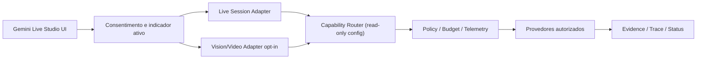

# F2 — V1.2 Multimodal Intelligence | Planejamento pré-fase

**Missão:** MCF-GEMINI-LIVE-EVOLUTION-20261116-001
**Repositório:** leon337/multiagent-collaboration-framework
**Fonte de verdade do status:** Issue #527
**Autoridade final:** LEANDRO · **Orquestrador:** MESTRE · **Gate interno:** LÉO
**Estado:** `PLANEJAMENTO_APENAS` — F2 **não iniciada**, sem branch de implementação, sem merge/deploy.

## Dependências e condição de início

O ROADMAP.md atual exige **gate F0 aprovado → gate F1 aprovado → execução F2**. Em 2026-11-16 o último estado observado tem F0.8 pendente, F1 em correção e PRs #528/#529 em draft. Os gates externos anteriores de LÉO-perfil retornaram para correção. Este documento não contorna a sequência normativa nem aprova uso de chave não rotacionada em produção.

## Problema e meta

Conectar percepção visual, processamento multimodal complementar, transcrição/tradução, roteamento por capacidade e memória opt-in ao Gemini Live Studio **sem transformar o modelo de voz em executor privilegiado**. Preservar privacidade e controles do navegador. O que já existe (captura básica de câmera/tela a 1 FPS, imagem e voz) é uma baseline, **não é qualificação F2 de consentimento/capacidade/retention**.

## Requisitos MVP de F2 (somente após os gates)

1. **Consentimento de câmera e tela:** estado ativo sempre visível, indicação de qual stream está indo ao provedor, botão de interromper que efetivamente encerra todas as MediaStreamTracks e transmissão; política sem captura automática nem reativação silenciosa após reconexão.
2. **Matriz por capacidade real:** modelo/endpoint selecionado + flags demonstradas (`realtime_voice`, `screen_image`, `camera_frame`, `transcription`, `translation`, `long_video`) com testes de handshake e payload, limites de frames, estimativas de custo e erros. Nunca inferir capacidades só pelo nome do modelo.
3. **Fallback de análise de vídeo/imagem:** pipeline complementar explícito, iniciado pelo usuário, com budget e indicador quando áudio Live não é suficiente. Correlacionar a tarefa e a resposta por `trace_id`, nunca enviar tela bruta para tools extras sem nova confirmação.
4. **Transcrição e tradução como modos isolados:** UI identifica claramente modelo, fonte, privacidade e retorno, incluindo PT-BR. Não misturar tradução automática com ferramentas de execução.
5. **Memória opt-in (posterior no MVP):** consentimento por sessão, política de retention/export/delete, segregação local, filtro de dados sensíveis; zero persistência por padrão.

## Arquitetura candidata

- **Client:** MediaStreamTrack lifecycle, banners de consentimento, estados e stop; nenhum modelo decide iniciar câmera ou tela autonomamente.
- **Servidor local:** criação de token efêmero, adapters por modelo, limits/quotas, rate/size/timeout guard, redaction de logs; não registrar quadros brutos.
- **Router:** compatibilidade determinística e fallback autorizado, sem contornar 429 via troca de credenciais.
- **Memory adapter:** opt-in e armazenamento separado; não colocar notas persistidas dentro dos próprios logs operacionais.

## Riscos e gates

| Risco | Controle/critério de aceite |
|---|---|
| Captura involuntária | Confirmação explícita antes do stream, indicador constante e kill-switch efetivo |
| Vazamento de mídia | Egress restrito, redaction, testes negativos de logs e zero retenção padrão |
| Modelo incorreto/quota | Catálogo verificado sob chave autorizada; não inventar disponibilidade |
| Custo variável | Budget por modalidade, limites de resolução/frequência, metering identificado |
| Queda/reconexão | Não retomar câmera/tela automaticamente; reversão e cleanup completos |
| Perda de governança | Auditoria independente, PRF, gate de LÉO e HUMAN_GATE LEANDRO quando requerido |

## Plano técnico sugerido (execução futura)

- **F2.0:** contrato de fase, threat-model multimodal e baseline F1 liberada.
- **F2.1:** consentimento + indicadores + stop tracks + testes de negação.
- **F2.2:** matriz de capacidades comprovadas com provider/endpoint/quotas e custo.
- **F2.3:** pipeline de análise visual sob autorização separada e correlação de trace.
- **F2.4:** tradução/transcrição em modos isolados com testes PT-BR.
- **F2.5:** memória opt-in com retention/export/delete e revisão de privacidade.
- **F2.6:** PRF E2E/rollback, QA, Emily e gate LÉO.

**MVP mínimo:** F2.0–F2.2 antes de expandir visão. **Não implementar F2 antes dos gates F0 e F1.**

## Evidência de autorização e mudança de fase

A solicitação atual de LEANDRO é continuar a missão para chegar à próxima fase. Isso autoriza avançar a correção e documentar o planejamento; **não é evidência de que os gates F0/F1 passaram**. Até sua conclusão, manter F2 como `PLANEJAMENTO_APENAS`.

## Gate externo F1 Q3
Avaliador Codex CLI sob perfil de LÉO no SHA c6f85b083837b297bd1bf04cba0e6582c5861afe: **RETORNAR_PARA_CORRECAO** (thread 01a1e6e0-7292-71b1-8ff2-738d098e268c). A decisão não autentica uma Agent Session nativa nem altera o gate aberto de F0.8. F2 permanece **somente planejamento**, sem código ou deploy.
