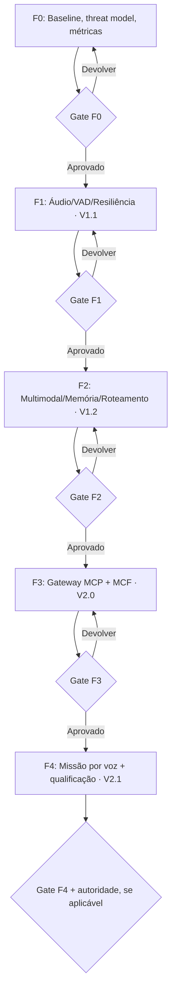

# Roadmap — Gemini Live Studio Evolution (V1.1 → V2.1)

**Mission:** `MCF-GEMINI-LIVE-EVOLUTION-20261116-001` · **Gate formal mais antigo pendente:** `F0.8` · **Engenharia:** F1–F3 local, Studio básico em main via PR #544; voz por desafio ainda no PR #540 · **Estado executivo e checklist:** [Issue #527](https://github.com/leon337/multiagent-collaboration-framework/issues/527).

**Natureza:** plano técnico versionado. Este roadmap não é prova de que uma funcionalidade foi implementada. **Fases ordenadas por dependência e gates, não por datas prometidas.** Só atualizar estado real na Issue com evidência.

## Visão de produto

**Problema:** a aplicação local tem conectividade Gemini Live, mas carece de uma base qualificada de áudio multimodal, segurança, observabilidade e ferramenta governada. Um modelo que fala não pode ser confundido com executor autorizado do MCF.

**Alvo:** interface única voz + tela + visão + texto, com roteamento por capacidade e custo; intenção validada por um gateway; ações via runtime MCF existente; receipts/telemetria; resultado falado com estado honesto.

**MVP de engenharia (F0 + F1):** áudio estável e observável com plano de segurança e testes reprodutíveis, preservando o backend local e sem dependência de ferramentas externas.

**Não-MVP (F2–F4):** memória persistida, tradução/transcrição especializada, roteamento, MCP/MCF, execução de missões por voz.

## Sequenciamento e dependências

## F0 — Baseline e governança da aplicação (FUNDATION)

**Objetivo:** confirmar o que realmente roda, congelar estado auditável e definir testes antes da refatoração.

**Entregáveis:**
1. Inventário local (hostname/device ID, cópia sanitizada do código, versões Node/SDK, portas, processos, permissões) e hash do snapshot; preferência por repositório próprio privado se for necessário versionar a aplicação.
2. Verificação de modelos por método `bidiGenerateContent`, disponibilidade por chave/projeto, limites e compatibilidade; registrar horário/endpoint, sem presumir cota ilimitada.
3. Auditoria de tokens efêmeros, cofre local, CORS, CSP, endpoints `/api/key`/`/api/token`, eventual exposição do loopback, dados sensíveis e logs.
4. Matriz experimental: 2.5 Flash Native Audio / 3.8 Live / Extended Thinking e modelos especializados aplicáveis (se disponíveis); conexão não comprova áudio, ferramenta nem visão.
5. Testes de baseline em dispositivos reais: fala→resposta, interrupção, legenda, câmera, tela, imagem, função segura, captura de erro e encerramento sem vazamento.
6. Contrato de telemetria `session_id`, `request_id`, `model_id`, `mode`, `token_usage`, latências (p50/p95), `error_code`, reconexões, tempo de streaming, confirmação de consentimento e custo estimado; **sem conteúdo pessoal por padrão**.
7. Checklist Issue atualizado por evidência e especificação de sincronizador CI/PR→Issue. A automação que atualiza estados será implementada apenas com teste anti-falsos-positivos e permissões mínimas.
8. PRF de F0, revisão de Emily e gate LÉO.

**Aceite:** baseline reproduzida, erros rastreáveis, ausência de segredos em evidências, relatórios e gate registrados. Estado `VALIDADO` somente após E2E observável.

## F1 — V1.1 Audio Reliability

**Objetivo:** produzir diálogo full-duplex **de baixa latência** e resiliência mensurável, mantendo o modelo correto e a política de uso.

**Entregáveis técnicos:**
- Captura `AudioWorklet` substituindo `ScriptProcessorNode`, resampling determinístico para PCM16 16 kHz; frame queue com blocos curtos e limite de `bufferedAmount`.
- Saída PCM 24 kHz com jitter buffer, playback monotônico, interrupção `barge-in` e cancelamento de áudio pendente.
- VAD híbrido (servidor+cliente) sujeito a suporte do modelo; calibrar prefix padding, silêncio, false-positive, turn finalization.
- `GoAway`, `generationComplete`, `sessionResumptionUpdate`, reconexões, `backoff` com limite e limpeza de recursos; evitar duplicação de turnos/requisições.
- Benchmark repetível: tempo do fim da fala ao primeiro áudio, p50/p95, underruns, cortes, interrupções, erros WebSocket, reconexões e custo/token.
- Teste de sessão longa com compressão e retomada; relatório de compatibilidade por modelo.

**Gate F1:** QA com microfone/alto-falante reais, falhas induzidas de rede, relatório antes/depois e PRF; sem prometer metas numéricas antes de obter a baseline de F0. Definir SLO experimental após F0.

## F2 — V1.2 Multimodal Intelligence

**Objetivo:** disponibilizar entradas multimodais e inteligência especializada sem falsificar capacidades nativas do endpoint Live.

**Entregáveis técnicos:**
- Câmera e tela com consentimento explícito, indicação persistente de captura ativa e `stop tracks` confiável; vídeo Live dentro do limite real suportado por endpoint.
- Pipeline de análise complementar para imagens/vídeos longos de alta resolução; resultado correlacionado com `trace_id` e enviado ao Live para diálogo, sem propagação automática de mídia sensível.
- Router de capacidade: `realtime_voice`, `thinking_voice`, `transcription`, `translation`, `multimodal_analysis`, `text_executor`; fallback somente compatível e autorizado, sem trocar credencial para contornar limite.
- Memória opt-in com retention, delete/export, consentimento por sessão e proteção de dados; recuperação por contexto, não reprodução irrestrita de mídia bruta.
- Modos separados de tradução/transcrição e organização de evidências. Avaliar 3.5 Transcribe/Translate conforme catálogo e quotas disponíveis; não supor acesso.
- E2E de imagem, câmera/tela, perda de conexão, fallback, privacidade e limites de dados.

**Gate F2:** consentimento, isolamento, revisão de qualidade e custo por classe de tarefa, auditoria e PRF.

## F3 — V2.0 MCF Tool Gateway

**Objetivo:** conectar o MESTRE Live ao runtime canônico **sem substituí-lo por um executor sem controle**.

**Entregáveis técnicos:**
- Descoberta e reutilização do gateway/adapters existentes do MCF/DSH; contratos idempotentes com `mission_id, phase_id, session_id, request_id, idempotency_key, evidence_ref, receipt_id`.
- Primeira ação real apenas **READ_ONLY** (ex.: inspecionar status de um serviço ou logs sanitizados), com tool-call request e resposta verificável.
- Autorização por classe de operação `READ`, `WRITE`, `DESTRUCTIVE`; HDF/HUMAN_GATE sempre que exigido pelo boundary; UI de revisão em link único apenas se devidamente autenticada.
- Reconcile após timeout: `status_by_idempotency_key`, receipts e replay protection. O modelo não assume que timeout significa falha nem que execução ocorreu.
- Contratos de cancelamento, async tools e `interactionStatus` por modelo, sem ferramenta indevida para modo especializado.
- Injeção de prompt por texto, ferramenta e mídia tratada como entrada não confiável; egress restrito; testes negativos antes de qualquer WRITE.

**Gate F3:** ação read-only comprovada ponta a ponta, receipts válidos, segurança com casos adversos, auditoria independente e PRF. Escrita segue gate específico posterior.

## F4 — V2.1 Voice-to-Mission

**Objetivo:** permitir missões orientadas por voz com resultado verificável, governança e continuidade.

**Entregáveis técnicos:**
- Fluxo `áudio → intenção estruturada → contrato MCF → planner/seleção → HDF → executor → receipt → resposta por voz`.
- Missão supervisionada demonstrativa: investigar erro visível com tela compartilhada, consultar logs autorizados, gerar diagnóstico e explicar por voz **com evidence links**.
- Painel de observabilidade: sessões, gateway, tool calls, custo, latência, falhas, gates, responsáveis, checkpoints e histórico; filtro por missão.
- Recuperação CAF, retry idempotente, handoff cross-session, cancelamento seguro, limites de orçamento/tempo/ações.
- Matriz comparativa de qualidade/latência/custo dos modelos autorizados; critérios de decisão de roteamento.
- Qualificação final: tests E2E (incluindo limites, concorrência, quota e segurança), rollback, PRF, auditoria Emily e gate LÉO. Exposição pública/deploy exige decisão separada da autoridade humana.

## Critérios transversais de qualidade

| Qualidade | Como comprovar |
|---|---|
| Segurança | testes negativos, exame de redaction, permission profiles, HDF e relatórios de Júlia/Emily |
| Observabilidade | evento correlacionado → evidence ref → receipt; spans/latência demonstráveis |
| UX | interrupção natural, estado de câmera/mic, mensagens de erro e acessibilidade |
| Disponibilidade | reconexão/cleanup e testes de falha de rede e quota |
| Custo | token metering, custos estimados identificados como estimativas e limiar de orçamento |
| Compatibilidade | matriz por modelo/endpoint atual, especialmente calling síncrono/assíncrono |
| Reversibilidade | branch isolada, mudanças migráveis e rollback validado |
| Governança | PRF, auditoria, gate, checkpoint, ausência de deploy acidental |

## Caminho crítico, riscos e mitigação

| Risco | Impacto | Controle |
|---|---|---|
| Credencial exposta em source/log | Alto | cofre local, rotacionar chave exposta, remover tokens de URLs/logs |
| Modelo indisponível/deprecated ou quota 429 | Alto | verificação de catálogo/limite live, fallback por capacidade, backoff |
| Áudio perde sincronização ou aumenta latência | Alto | AudioWorklet, benchmark p50/p95, filas limitadas e cancellation |
| Sessão desconecta após limite/GoAway | Alto | compressão/retomada por handle, E2E longo |
| Mídia pessoal transmitida indevidamente | Alto | consentimento por stream, allowlist, redaction e encerramento real |
| Tool call executada em duplicidade | Crítico | idempotency key + receipt + reconciliação |
| Prompt injection do conteúdo de tela | Crítico | classificar entrada como não confiável; HDF, ferramentas restritas |
| Mistura do MESTRE Live e executor MCF | Alto | gateway/adapters específicos; papel e gate separados |
| Checklist marcado sem prova | Médio | atualização baseada em evidência + auditoria; CI isolado não conclui item |

## Protocolo de entrega por fase

1. Abrir checkpoint e missão na Issue #527; reavaliar evidência e fonte real.
2. Delegar somente a agente com competência, registro de execução real e handoff.
3. Implementar em branch isolada, associar PR com itens `F*.n`; testes e validação.
4. Gerar PRF completo em `artifacts/phases/PHASE-GEMINI-LIVE-EVOLUTION-XX/`; emitir manifest com hashes.
5. Auditar (Emily), decidir gate (LÉO), atualizar checklist com evidência e checkpoint.
6. Iniciar a próxima fase somente quando critério e gate aprovados; **não automatizar merge/deploy**.

A Issue #527 é a única fonte de estado vivo; este documento pode mudar por PR/commit, mas nunca marca progresso automaticamente.
