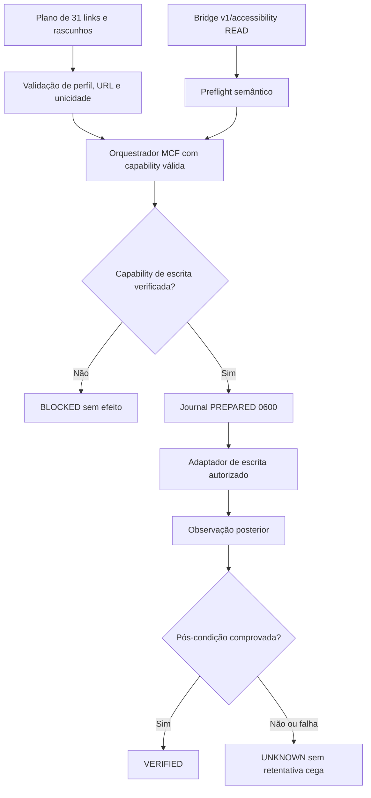

# MCF — Instagram: diagnóstico e executor de interação governada

**Missão:** MCF-INSTAGRAM-INTERACTION-20261110
**Autoridade final:** LEANDRO
**Orquestrador:** MESTRE
**Estado da implementação:** preflight real e núcleo de execução testado por simulação; **nenhuma publicação real autorizada por este módulo**.
**Base:** branch `feat/mcf-agent-bridge-mestre-readonly-20261108` no commit `00331d52`.
**Fonte de verdade consultada:** `main` remoto em `0bcea848934ada8593a9ff8be86ea3a41157e546` (10/11/2026).

## Problema demonstrado

No `notebook-team2`, o Instagram possui quatro botões acessíveis com o nome "Curtir":
um para a publicação principal e três para comentários. Seletores globais por
texto ou SVG são ambíguos. Um disparo por `/v1/click` com seletor SVG retornou
HTTP 500 `internal_error`; isso **não comprova bloqueio no Instagram**.
Uma tentativa posterior sofreu restrição de execução da ferramenta. Esses
bloqueios não devem ser ignorados nem contornados.

O `/v1/interactive` retorna elementos genéricos editáveis, mas não informa
com precisão o botão principal de curtida. O `/v1/accessibility` retorna
uma árvore semântica que torna possível identificar o grupo:

```text
Mais opções → Curtir → [contador] → Comentar → [contador] → Compartilhar → Salvar
```

Os demais botões `Curtir` aparecem ao lado de `Responder` e não são o alvo
da operação principal.

## Arquitetura implementada



- `social_interaction.py`: validador de URLs, seletor da ação principal na
  árvore de acessibilidade, máquina de estados por ação e journal `0600`.
- `social_interaction_cli.py`: ferramentas **somente leitura** `diagnose`
  e `plan`; **não** possuem `click`, `type`, `submit` ou upload.
- `bridge_adapter.py`: adiciona `GET /v1/accessibility` à allowlist de
  leituras, sempre após reconciliação de discovery e instância.
- `test_social_interaction.py`: testes determinísticos com adaptador falso,
  sem alterar a conta externa.

## Verificação reproduzível

```bash
cd tools/agent-bridge-adapter
python3 -m unittest discover -s . -p 'test_*.py' -v
python3 social_interaction_cli.py diagnose \
  --instance notebook-team2 \
  --profile mnt_visionario \
  --url https://www.instagram.com/mnt_visionario/p/DJR_x-nubA5/
python3 social_interaction_cli.py plan \
  --profile mnt_visionario \
  --source /home/leo/agent-sandbox/artifacts/instagram-mnt_visionario-2026-11-10-engajamento-dry-run.json
```

Resultado visual real de preflight: um botão de curtida principal identificado,
três botões de comentários desconsiderados, editor encontrado, postagem correta
e nenhuma mutação de conta.

## Política e limites

O protocolo oficial `MCF-PROTOCOLO-DUAL-BROWSER-RUNTIME-DISCOVERY.md` determina
que discovery é descritivo, **não transfere autorização** e
`falseGreenAllowed=false`. O `Human Delegation Firewall` impede a
reclassificação de uma falha como sucesso. O adaptador de leitura **não** concede
direitos de escrita.

O núcleo `execute_one` somente pode ser usado por um runtime com capability
externa validada, contendo a vinculação entre conta, perfil, postagem, operação
e política. Ele aceita um único passo por invocação e usa um adaptador injetado;
não se conecta diretamente a endpoints de escrita. O booleano recebido por
`execute_one` é apenas um sinal passado pelo runtime que o chama e **não
substitui** uma verificação criptográfica nem a emissão do gate canônico.
Enquanto a integração canônica não existir, uso real permanece BLOQUEADO.

Critério de evidência para LIKE: confirmação de `likedByMe` **e** mudança de
botão primário de `Curtir` para `Descurtir`. Para COMMENT: texto publicado
observado na autoria correta após operação, não apenas no campo de digitação.
Falhas de resposta resultam em `UNKNOWN`, com reconciliação obrigatória antes
de qualquer retentativa. Nenhuma alteração no Instagram deve ser inferida de
simulação, de um log de tentativa ou de animações de interface.

## Separação MVP / próximo marco

**MVP implementado:** diagnóstico observacional real, seleção semântica,
planejamento dos 31 itens (27 textos, 4 pendentes), validação offline com
postconditions e journal de idempotência.

**Futuro:** integrar `WriteCapability` com `PermissionEngine`,
`ExternalActionDispatcher` e `EvidenceValidator`; receber evidência
autenticada de que um grant foi emitido para perfil e operação; construir
adaptador de escrita não genérico no Browser com isolamento; testar uma
operação real controlada e reversível quando permitido; registrar comparação
antes/depois e interromper sob CAPTCHA, rate limit, negação de política ou
ambiguidade de UI.

**Não executado:** curtidas ou comentários automáticos em massa, manipulação
das configurações da conta, update da AppImage em execução, merge e deploy.
